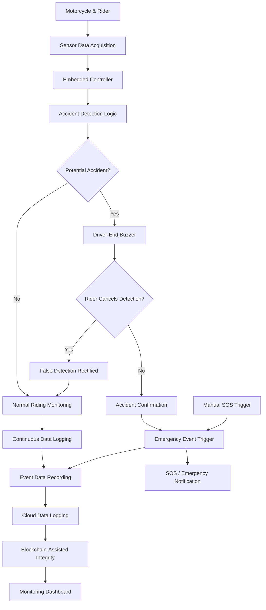

# 🏍️ Motorcycle Blackbox

### IoT-Based Intelligent Accident Detection, Event Recording & Emergency Response System

---

## 1. Project Overview

Motorcycle Blackbox is an intelligent IoT-based motorcycle safety and event recording system designed to detect potential road accidents, monitor riding conditions, preserve critical event data, and support timely emergency response.

Inspired by the event data recording mechanisms used in modern vehicles, the proposed system brings intelligent accident monitoring capabilities to two-wheelers through sensor-based data acquisition, embedded processing, driver interaction, and connected data management.

The system continuously monitors relevant riding parameters and evaluates abnormal events through a controller-based decision-making mechanism. When a potential accident is detected, the rider is provided with an opportunity to rectify false detections through an onboard buzzer-based confirmation mechanism.

If an actual accident is confirmed, the system records the associated event information and initiates the emergency notification workflow. A dedicated manual SOS trigger is also incorporated to allow riders to request assistance even when an accident is not automatically detected.

The project also aims to integrate cloud-based event logging, blockchain-assisted data integrity, and a real-time monitoring dashboard to provide a transparent and accessible accident-record management platform.

**The ultimate objective is to transform conventional motorcycle safety monitoring into an intelligent, connected, and data-driven emergency response ecosystem.**

---

## 2. Problem Statement

Motorcycle riders remain particularly vulnerable during road accidents due to limited physical protection and the possibility of delayed emergency assistance.

In many accident situations:

- The rider may become unconscious or physically incapable of requesting help.
- Emergency responders may not receive immediate accident notifications.
- Critical information about the incident may be lost.
- False accident detections can result in unnecessary emergency alerts.
- Conventional two-wheelers lack an integrated mechanism for continuous riding-event monitoring and reliable event documentation.

There is a need for an affordable, intelligent, and adaptable system that can identify potential accidents, distinguish false detections, preserve important event information, and facilitate emergency communication.

Motorcycle Blackbox addresses these challenges through an integrated IoT-based monitoring and event recording approach.

---

## 3. Proposed Solution

The proposed solution combines embedded sensing, intelligent decision-making, rider interaction, emergency communication, and digital event management.

The system is designed around the following functional modules:

1. **Sensor Data Acquisition:** Collects relevant riding and motion parameters through connected sensors.
2. **Controller Processing:** Processes incoming sensor information and evaluates abnormal riding conditions.
3. **Accident Detection:** Identifies potential accident conditions using predefined detection logic.
4. **False Detection Management:** Activates an onboard buzzer to provide the rider with an opportunity to cancel an incorrect detection.
5. **Emergency Response:** Initiates the accident notification workflow when an event is confirmed.
6. **Manual SOS:** Enables the rider to manually trigger an emergency alert.
7. **Event Data Logging:** Preserves relevant sensor readings and event information.
8. **Cloud Integration:** Supports centralized storage and remote access to recorded event information.
9. **Blockchain-Assisted Integrity:** Aims to provide tamper-evident event records through blockchain-based verification.
10. **Monitoring Dashboard:** Presents recorded events and relevant monitoring information through an interactive interface.

---

## &#x20;4. System Architecture

The overall architecture follows a modular approach, connecting the physical sensing layer with embedded processing, emergency communication, and digital data management.



*Note: This represents the intended end-to-end system architecture. Individual integrations are being developed and validated in stages.*

---

## &#x20;5. Working Methodology

### 5.1 Continuous Sensor Monitoring

The system collects relevant motorcycle motion and riding parameters through the connected sensing modules.

The collected information is forwarded to the embedded controller for processing and evaluation.

### 5.2 Intelligent Accident Detection

The controller evaluates sensor readings against predefined conditions to identify abnormal events that may indicate a motorcycle accident.

The detection mechanism is designed to distinguish normal riding variations from potentially hazardous situations.

### 5.3 False Detection Handling

When a potential accident is detected, the system activates an onboard buzzer to alert the rider.

If the detection is incorrect and the rider is able to respond, the rider can cancel the alert through the designated interaction mechanism.

This prevents unnecessary emergency notifications caused by false detections.

### 5.4 Confirmed Accident Response

If the rider does not rectify the potential detection within the configured response period, the event proceeds through the accident confirmation workflow.

The system records the relevant event information and initiates the configured emergency notification process.

### 5.5 Manual SOS Activation

The system incorporates a dedicated manual SOS trigger.

This feature allows riders to initiate an emergency request independently of automatic accident detection.

It is particularly useful in situations where the rider requires assistance without a detectable accident event.

### 5.6 Event Data Recording

The system is designed to preserve relevant information associated with normal riding, detected anomalies, false detections, confirmed accidents, and manually triggered SOS events.

This provides a structured event history for monitoring, analysis, and future investigation.

### 5.7 Cloud and Blockchain Integration

The proposed digital data management layer supports centralized event storage and remote accessibility.

Blockchain-assisted verification is intended to strengthen the integrity and traceability of important event records.

### 5.8 Dashboard-Based Monitoring

The Streamlit dashboard provides an interactive interface for presenting motorcycle monitoring information, sensor-related visualizations, and recorded event information.

It serves as the visualization and monitoring layer of the overall system.

---

## 🖥️ 6. Dashboard – Motorcycle Blackbox

The project includes a Python-based Streamlit dashboard developed to visualize and monitor motorcycle safety-related information.

### Dashboard Objectives

- Present relevant sensor information through an interactive interface.
- Visualize riding parameters and monitoring data.
- Display accident-related event information.
- Support event history and data interpretation.
- Provide a foundation for future cloud-connected monitoring.

### Dashboard Technologies

| Technology | Purpose                                  |
| ---------- | ---------------------------------------- |
| Python     | Core application development             |
| Streamlit  | Interactive dashboard interface          |
| Pandas     | Data manipulation                        |
| NumPy      | Numerical operations and data processing |
| Plotly     | Interactive data visualization           |

### Dashboard Screenshots

Add actual screenshots of your working dashboard in the `assets/` directory.

Example:

```markdown

```

Additional screenshots can include:

- Main dashboard interface
- Sensor monitoring visualizations
- Accident event monitoring
- Event history and analytics

---

## &#x20;7. Technology Stack

### Hardware Layer

The proposed embedded system may incorporate:

- Microcontroller development board
- Motion and orientation sensing modules
- GPS/location tracking module
- Buzzer for rider alerts
- Manual SOS trigger
- Emergency cancellation/control interface
- Communication modules for data transmission
- Power management circuitry

*Exact component models and specifications will be documented as the hardware implementation is finalized.*

### Software Layer

| Technology             | Application                         |
| ---------------------- | ----------------------------------- |
| Python                 | Dashboard and data processing       |
| Streamlit              | Monitoring interface                |
| Pandas                 | Data handling                       |
| NumPy                  | Numerical computation               |
| Plotly                 | Interactive visualizations          |
| Arduino / Embedded C++ | Embedded firmware, where applicable |
| Git & GitHub           | Version control and collaboration   |

### Digital Infrastructure

- Cloud-based event data storage
- Remote monitoring and data accessibility
- Blockchain-assisted data integrity
- Emergency notification integration

*These infrastructure elements represent the proposed integration scope and should not be considered deployed until implementation and testing are complete.*

---

## &#x20;8. Event Handling Scenarios

The system is designed to address multiple riding and emergency scenarios.

| Scenario           | System Response                              |
| ------------------ | -------------------------------------------- |
| Normal riding      | Continuous monitoring and data logging       |
| Potential accident | Driver-end buzzer activation                 |
| False detection    | Rider cancels the alert                      |
| Confirmed accident | Event recording and emergency workflow       |
| Manual emergency   | SOS trigger activation                       |
| Event completion   | Data preservation and dashboard availability |

The system follows a structured decision-making process to reduce unnecessary alerts while supporting emergency assistance when required.

---

## &#x20;9. Data Management and Integrity

Reliable event information is an important part of the Motorcycle Blackbox concept.

The proposed data management architecture focuses on:

- Structured event recording.
- Timestamp-based event identification.
- Preservation of relevant sensor information.
- Cloud-based accessibility.
- Secure handling of emergency-related records.
- Blockchain-assisted verification of critical records.

The blockchain layer is intended to provide an additional integrity mechanism rather than replace conventional event storage.

---

## &#x20;10. Project Setup and Installation

Follow these instructions to run the current dashboard locally.

### Prerequisites

- Python 3.10 or later (subject to dependency compatibility).
- Visual Studio Code or another Python-compatible editor.
- Git.
- Internet connection for installing dependencies.

### Step 1: Clone the Repository

```bash
git clone https://github.com/Darius-27/Motorcycle-blackbox.git
```

### Step 2: Navigate to the Project Directory

```bash
cd Motorcycle-blackbox
```

### Step 3: Create a Virtual Environment

```bash
python3 -m venv .venv
```

### Step 4: Activate the Virtual Environment

For macOS / Linux:

```bash
source .venv/bin/activate
```

For Windows:

```bash
.venv\Scripts\activate
```

### Step 5: Install Dependencies

```bash
pip install -r requirements.txt
```

### Step 6: Run the Dashboard

```bash
streamlit run dashboard.py
```

The dashboard will open in your default browser.

If it does not open automatically, access:

```text
http://localhost:8501
```

---

## 11. Repository Structure

The repository is intended to follow a modular structure as the project expands.

```text
Motorcycle-blackbox/
│
├── dashboard.py
│
├── requirements.txt
│
├── README.md
│
├── assets/
│   ├── dashboard-overview.png
│   ├── system-architecture.png
│   └── circuit-diagram.png
│
├── firmware/
│   ├── sensor-acquisition/
│   ├── accident-detection/
│   └── emergency-control/
│
├── documentation/
│   ├── project-report.pdf
│   ├── block-diagram.png
│   └── working-methodology.md
│
├── cloud/
│   └── event-logging/
│
└── blockchain/
    └── data-integrity/
```

*The folders shown above are the planned organizational structure. Only add modules and files when they actually exist in the repository.*

---

## 12. Testing and Validation

The project will be evaluated through structured testing of individual modules and complete system operation.

### Key Validation Areas

1. Sensor data acquisition accuracy.
2. Normal riding condition monitoring.
3. Potential accident detection response.
4. False-positive detection and rider cancellation.
5. Confirmed accident event handling.
6. Manual SOS activation.
7. Event recording consistency.
8. Cloud data transmission and retrieval.
9. Blockchain integrity verification.
10. Dashboard data visualization.

### Performance Indicators

| Indicator                | Evaluation Method                                |
| ------------------------ | ------------------------------------------------ |
| Detection accuracy       | Compare detections with validated test scenarios |
| False-positive rate      | Measure incorrect accident detections            |
| Alert response time      | Measure time between detection and notification  |
| Data logging reliability | Verify completeness of recorded events           |
| SOS functionality        | Validate manual emergency activation             |
| Data integrity           | Verify stored event records                      |
| Dashboard reliability    | Test data visualization and availability         |

Quantitative performance targets will be established after hardware integration and controlled testing.

---

## 13. Expected Impact

Motorcycle Blackbox aims to contribute to safer and more responsive two-wheeler transportation.

Its expected impact includes:

- Faster identification of potential accident events.
- Improved emergency communication opportunities.
- Reduced unnecessary alerts through rider-assisted false detection handling.
- Better preservation of accident-related information.
- Improved accessibility of riding-event records.
- Support for data-driven road safety analysis.
- A scalable approach to connected motorcycle safety systems.

The solution is intended to benefit motorcycle riders, emergency response stakeholders, and communities seeking improved road safety infrastructure.

---

## &#x20;14. Future Enhancements

The project roadmap includes:

- Integration with physical motorcycle sensor hardware.
- Refinement of accident detection algorithms.
- Improved false-positive reduction.
- GPS-based accident location identification.
- Automated emergency notification integration.
- Real-time cloud synchronization.
- Blockchain-based event verification.
- Advanced event analytics and visualization.
- Mobile application integration.
- Extended testing under diverse riding conditions.

---

## &#x20;15. Development and Contributions

Motorcycle Blackbox is being developed as a modular engineering project, combining embedded systems, IoT, software development, data management, and road safety technologies.

Contributions and technical suggestions are welcome.

To contribute:

1. Fork the repository.
2. Create a feature branch.
3. Implement and test your changes.
4. Commit your changes with meaningful messages.
5. Submit a pull request describing your contribution.

---

## &#x20;16. Project Team

**Project:** Motorcycle Blackbox

**Project Domain:** Internet of Things | Embedded Systems | Smart Mobility | Road Safety

**Repository Maintainer:** Darius A

**GitHub:** [Darius-27](https://github.com/Darius-27)

*Add the remaining team members, institutional affiliation, mentors, and partner organization details here.*

---

## &#x20;17. License

The licensing terms for this project will be specified when the project ownership and intended distribution permissions are finalized.

---

## &#x20;18. Support the Project

If you find this project interesting, consider starring the repository and sharing it with others working in IoT, embedded systems, smart mobility, and road safety.

Your interest and feedback can help improve the development of intelligent motorcycle safety solutions.

---

\<p align="center">
&#x20; \<strong>Motorcycle Blackbox\</strong>\<br/>
&#x20; \<em>From Accident Detection to Intelligent Emergency Response.\</em>
\</p>

\<p align="center">
&#x20; Building a safer riding ecosystem through connected technology.
\</p>
